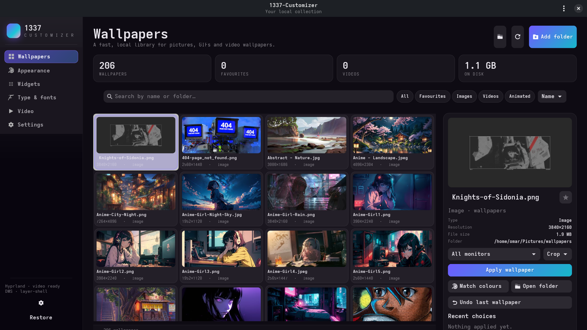
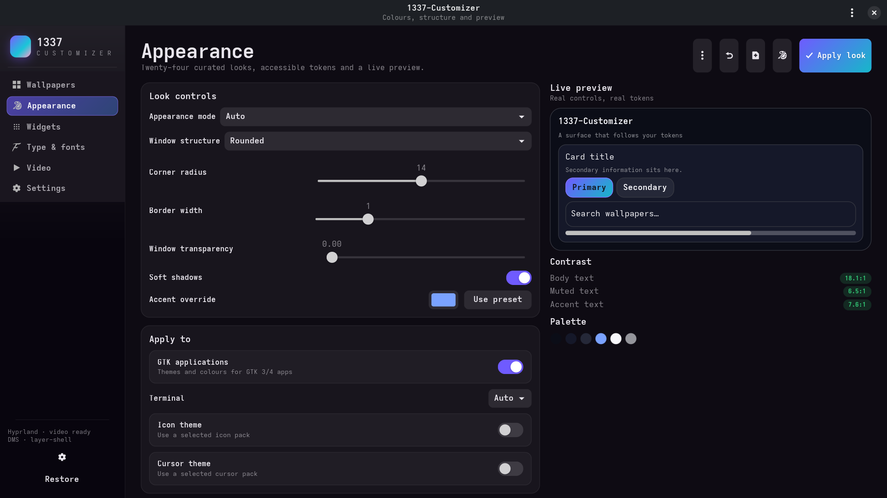
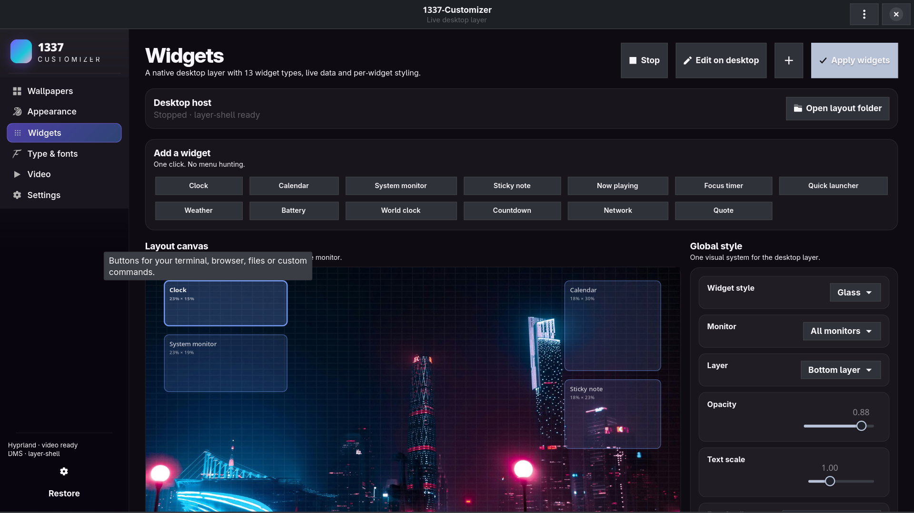
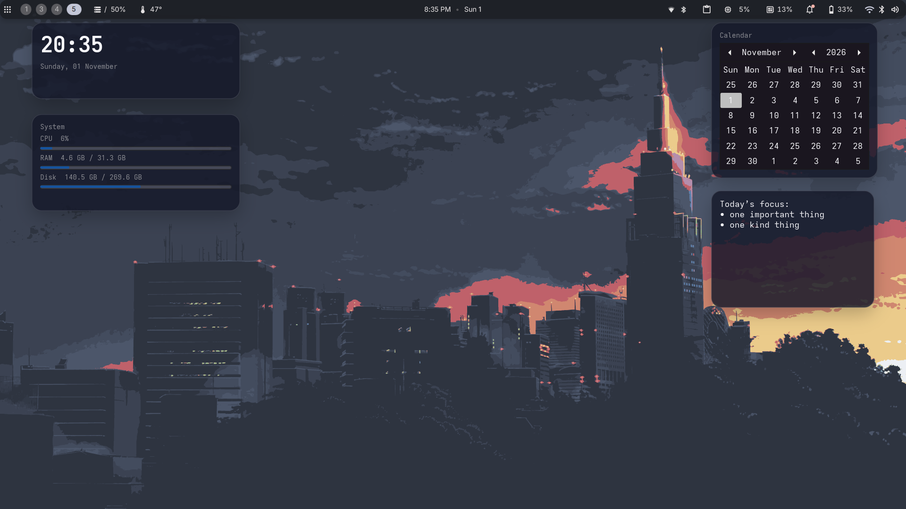
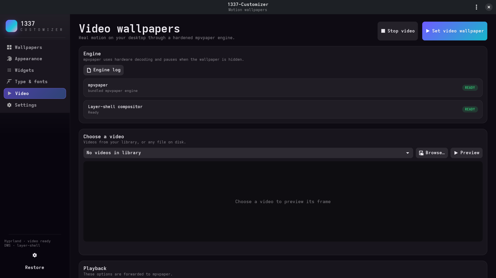

# 1337-Customizer

**A faster wallpaper, look, font and desktop-widget studio for Linux.**
Built for real work on Hyprland, wlroots compositors, GNOME and other GTK desktops.

1337-Customizer is an independent, from-scratch desktop studio inspired by the
idea behind Wallpaper Studio Plus: make wallpapers, themes and widgets feel like
one coherent system. It goes much further with real video wallpaper playback,
a virtualised image library, 24 curated looks, 13 live widget types, typography
tools and terminal themes.







The sidebar auto-collapses when the window is tiled narrow, with a header toggle
to bring it back as an overlay. Page content scrolls horizontally instead of
clipping controls.

## Why it is fast

- **Virtualised library grid** — only visible cards are decoded. 10,000 files
  do not create 10,000 widgets.
- **Worker-thread thumbnails** — JPEG thumbnails are generated out of process,
  cached on disk, and kept in an LRU in memory.
- **SQLite index with WAL** — metadata is re-probed only when mtime or size
  changes. Scans are batched and cancellable.
- **Lazy pages** — Appearance, Fonts, Widgets and Video are built the first
  time you open them.
- **Debounced search and model filtering** — typing never rebuilds the grid.
- **Separate widget process** — a widget crash cannot freeze the studio.
- **Hardware video** — mpvpaper uses `hwdec=auto-safe` and auto-pauses when the
  wallpaper is hidden.
- **No Electron, no web runtime** — native GTK 4 + libadwaita.

## What you get

### Wallpapers
- Multiple folders, recursive or flat scanning, drag and drop.
- Search, sort by name / newest / size / resolution / favourites.
- Favourites, filters for images, video and animated wallpapers.
- Per-monitor application with crop, fit, stretch or centre.
- Light/dark variants for GNOME.
- Animated GIF support through awww.
- Durable copy of applied pictures so moving the original does not break the
  wallpaper.
- Recent choices and one-click undo.
- Slideshow helper with interval, shuffle/name order and favourites-only mode.

Backends are selected at runtime:

| Session | Backend |
|---|---|
| Hyprland + DankMaterialShell | DMS `wallpaper setFor` |
| Hyprland / wlroots | awww, hyprpaper, swaybg |
| GNOME | native gsettings |
| KDE Plasma | `plasma-apply-wallpaperimage` |
| X11 | feh |

### Real video wallpapers
- One mpvpaper process per output.
- Fill/crop or fit, mute, loop, speed, hardware decoding and auto-pause.
- Auto-stop on fullscreen for games and video editing.
- Runs independently of the studio and restores at login when enabled.
- Bundled source archive and build script; the engine can also use a system
  `mpvpaper`.
- Graceful fallback: if the compositor has no layer-shell support, 1337-Customizer
  applies a high-quality still frame and explains why.

### Looks and themes
- **24 curated presets**: Midnight Aurora, Catppuccin, Nord, Tokyo Night,
  Gruvbox, Dracula, Rosé Pine, Everforest, Kanagawa, Solarized, One Dark,
  GitHub, Ayu, Cyberpunk, Vaporwave, Coffee, Paper & Ink, Neon Grid,
  Terminal CRT, Ocean Glass, Sakura, Mono Slate, Amber Dusk and Forest Moss.
- **Wallpaper colours** — sample a light and dark palette from the current
  picture, with WCAG checks shown in the preview.
- **Custom look editor** — pick six seed colours, save unlimited personal looks.
- **Window structures** — rounded, sharp, glass, neon, paper, pixel, minimal and
  retro.
- Fine controls for radius, border width, shadow, transparency and density.
- Optional light/dark schedule with a lightweight session helper.
- Apply GTK 3/4 CSS, terminal themes, icon packs, cursor packs and fonts.
- Export/import a theme as JSON.
- Live preview with real GTK controls and contrast ratios.
- Restore the previous look without touching unrelated user CSS.

### Widgets
Thirteen native widget types, all running in a layer-shell desktop host:

`Clock`, `Calendar`, `System monitor`, `Sticky note`, `Now playing`,
`Focus timer`, `Quick launcher`, `Weather` (with city lookup), `Battery`,
`World clock`, `Countdown`, `Network` and `Quote`.

- A one-click **add palette** with all thirteen widget types.
- A visible action bar for **duplicate, delete, bring forward and send back**.
- A visual canvas with drag-to-move and **right-drag-to-resize**.
- The desktop editor toolbar also has **Add**, **Duplicate**, **Delete** and a
  **Resize** mode, so you can work directly on the desktop.
- Per-widget x/y/width/height, opacity, scale, alignment, monitor pinning,
  interactive flag and data options.
- Eight widget skins: glass, solid, outline, neon, paper, pixel, terminal and
  minimal, with a **per-widget skin override**.
- Per-widget accent, background and text colours.
- Per-widget corner radius, border width, padding and drop shadow.
- Four ready-made layouts — Minimal, Dashboard, Focus, Ambient — plus duplicate,
  stacking-order controls, snap-to-grid and a configurable grid size.
- Global monitor, layer, opacity, accent, font family and text scale.
- Edit mode with Add/Duplicate/Delete/Resize controls; **Save & lock** returns
  to click-through.
- Locked widgets reload live when you save changes in the studio.
- Click-through by default; only widgets marked interactive receive clicks.
- Export/import layouts; reset to the built-in starter layout.
- CLI shortcuts: `1337-customizer widgets add clock`, `widgets list`,
  `widgets remove <id|index>` and `widgets reset`.
- The host is a separate process, so the studio stays responsive.





### Fonts and desktop controls
- Browse installed families with live Pango previews.
- Select interface, monospace and document fonts with a real font dialog.
- Text scale and cursor size.
- Install `.ttf`, `.otf`, `.ttc`, `.woff` and `.woff2` files locally.
- Icon theme, cursor theme, button layout, GTK animations, overlay scrollbars
  and middle-click paste.
- Restore only the font or desktop keys you changed.

### Settings and helpers
- Launch at login (autostart entry created only when enabled).
- Slideshow helper with start/stop and status.
- Restore look, wallpaper, desktop controls or all helpers.
- Diagnostics report and about dialog.

## Install

1337-Customizer is a source checkout with a per-user installer. No sudo is
required; the app uses the system Python and GTK already on your machine.

```bash
cd 1337-customizer
./install.sh --launch
```

This installs to `~/.local/share/1337-customizer`, creates
`~/.local/bin/1337-customizer`, installs the desktop entry and icon, and opens the
studio. Open **1337-Customizer** from your application menu or run
`1337-customizer`.

A self-extracting installer is also built at **`dist/1337-Customizer.run`**:
mark it executable once, then double-click it. It installs for the current
account, opens the studio, and never asks for sudo. Rebuild it with
`packaging/build-run.sh`.

To run directly from the checkout:

```bash
./1337-customizer
```

### Requirements

- Linux with Python 3.11+ and PyGObject
- GTK 4.14+ and libadwaita 1.5+
- Pillow (`python3-pil`)
- Cairo (`python3-cairo` / `python-cairo`) for layer-shell input regions
- `ffmpeg` / `ffprobe` for video thumbnails and frame fallback
- Optional: `awww`, DMS, GNOME, Plasma, feh for wallpaper backends
- Optional: `mpvpaper` and `mpv` for video wallpapers; the bundled engine works
  on systems where the build dependencies exist
- Optional: `gtk4-layer-shell` for desktop widgets and video layers
- Optional: `playerctl` for the Now Playing widget; `notify-send` for
  notifications

Ubuntu / Debian:

```bash
sudo apt install python3-gi python3-pil gir1.2-gtk-4.0 gir1.2-adw-1 \
  ffmpeg libgtk4-layer-shell0
```

Arch:

```bash
sudo pacman -S python-gobject python-pillow gtk4 libadwaita ffmpeg \
  gtk4-layer-shell
```

Video engine build dependencies (only needed if the bundled binary does not run):

```bash
# Arch
sudo pacman -S meson ninja wayland-protocols mpv
# Ubuntu
sudo apt install meson ninja-build libmpv-dev libwayland-dev wayland-protocols libegl1-mesa-dev
```

## First run

The default folder is a dedicated `~/Pictures/wallpapers` or
`~/Pictures/Wallpapers` folder when it exists, otherwise `~/Pictures`. Add more
folders from **Wallpapers → Add folder** or **Settings → Wallpaper folders**.

Click a picture to preview it; click **Apply wallpaper**. Videos use **Set
video wallpaper**. **Match colours** samples the current picture and applies a
matching look.

## Command line

The complete command reference is in **[COMMANDS.md](COMMANDS.md)** — every
CLI subcommand, flag, installer option, uninstall option, diagnostic command and
development command.

Quick examples:

```bash
1337-customizer set ~/Pictures/wallpapers/night.jpg --monitor eDP-1 --fit crop
1337-customizer theme midnight-aurora --mode dark
1337-customizer theme --list
1337-customizer next
1337-customizer undo
1337-customizer video start ~/Videos/aurora.mp4 --fit crop
1337-customizer video stop
1337-customizer video status
1337-customizer widgets start
1337-customizer widgets edit
1337-customizer widgets stop
1337-customizer slideshow start
1337-customizer slideshow stop
1337-customizer fonts --ui "Fira Sans 11" --mono "Fira Code 11" --scale 1.1
1337-customizer doctor
1337-customizer restore --scope look
1337-customizer restore --scope all
1337-customizer autostart on
1337-customizer about
```

`--background` starts the helpers enabled in settings without opening the
window. The autostart entry uses that mode.

## Project layout

```text
leet_customizer/
  app.py             application shell and actions
  config.py          JSON settings, defaults and migration
  library.py         SQLite index and media probing
  thumbnails.py      worker-thread thumbnail/preview cache
  palette.py         colour extraction and WCAG token generation
  themes.py          presets, custom looks and GTK/terminal CSS
  desktop.py         gsettings, themes, terminals, fonts and monitors
  wallpaper.py       DMS, awww, hyprpaper, swaybg, GNOME, KDE and X11
  video.py           mpvpaper engine control
  widgets.py         widget catalog, cards and shared CSS
  widget_daemon.py   layer-shell desktop widget host
  sessiond.py        slideshow and auto light/dark helper
  pages/             studio screens
engine/              bundled mpvpaper binary, source archive and build script
tests/               non-destructive unit tests
```

Run the tests from the checkout:

```bash
python3 -m unittest discover -s tests -v
```

## Restore and uninstall

- **Settings → Restore look** removes 1337-Customizer's GTK/terminal includes and restores
  the desktop keys it captured. Other custom CSS is preserved.
- **Settings → Restore wallpaper** returns to the previous DMS/GNOME wallpaper or
  the previous item in the recent list.
- **Stop all helpers** stops the widget host, video engine and session helper.
- `./uninstall.sh` restores the desktop, then removes the app and **every piece
  of app-owned data**: library database, config, saved looks, notes, applied
  picture copies, caches, logs, generated GTK/terminal themes, widgets layouts,
  autostart entries, launchers and icons. It also cleans the legacy Hamiid
  paths left by the previous name.
- `./uninstall.sh --keep-data` removes the app and generated themes but keeps
  the library, notes, saved looks and configuration.
- `./uninstall.sh --no-restore` skips restoring the previous desktop state.

## Notes and limits

- GNOME Shell, KDE panels, browsers, Qt/Electron apps and sandboxed apps are not
  guaranteed to follow GTK CSS. The look applies broadly to GTK 3/4 apps and is
  documented per target.
- Desktop widgets require a compositor with `wlr-layer-shell` for the best
  result. On GNOME Wayland they fall back to regular windows; layer-shell
  support varies.
- Video wallpapers require layer-shell on Wayland. On GNOME, 1337-Customizer falls back
  to a still frame and can coexist with extensions such as Hidamari.
- The bundled mpvpaper engine is GPL-3.0. Its source archive and license are in
  `engine/`. 1337-Customizer's own code is MIT-licensed.
- Nothing is uploaded. Weather uses Open-Meteo only when you configure a
  latitude and longitude. There is no account or telemetry.

## Credits

1337-Customizer is an independent implementation built with GTK 4, libadwaita,
Pillow, SQLite and mpvpaper. It is inspired by Wallpaper Studio Plus by
Adil Asselman (yuxev) and by the Linux desktop-customisation community.
