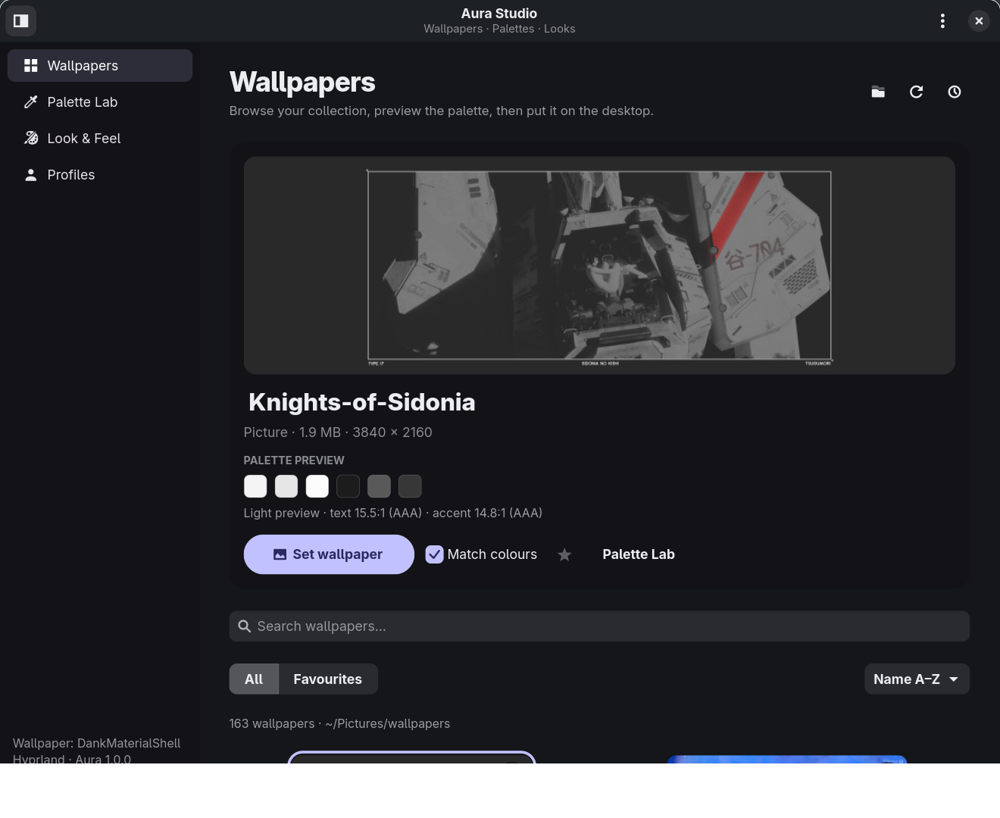
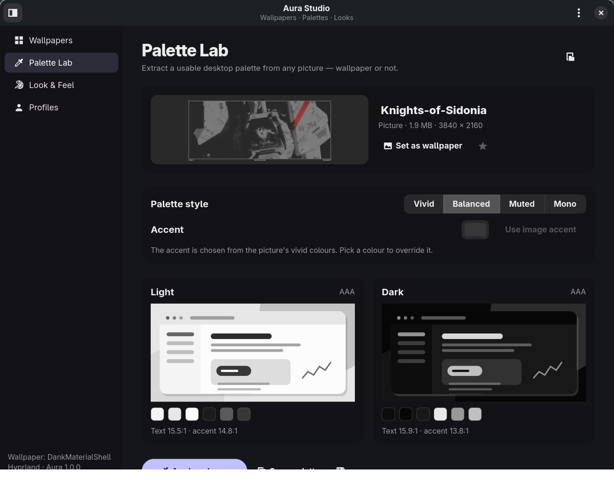
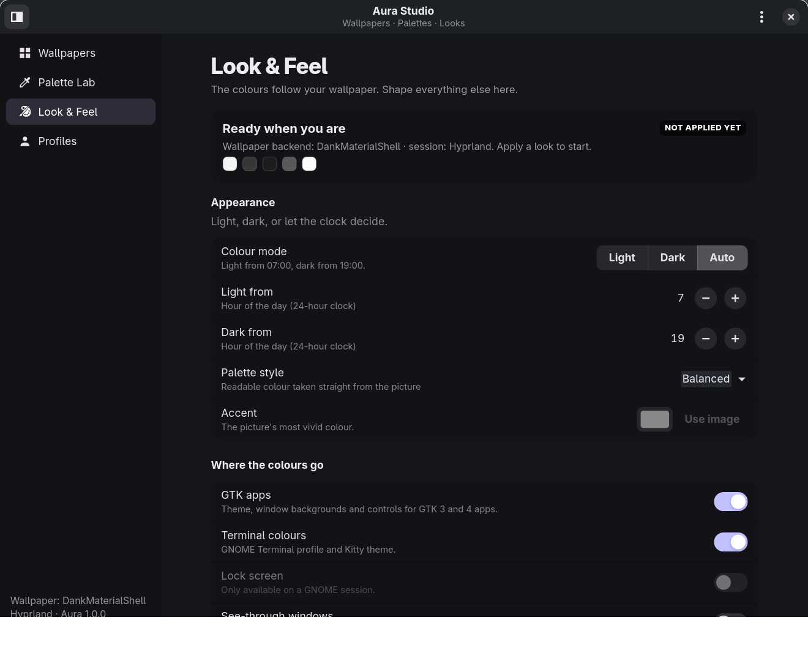
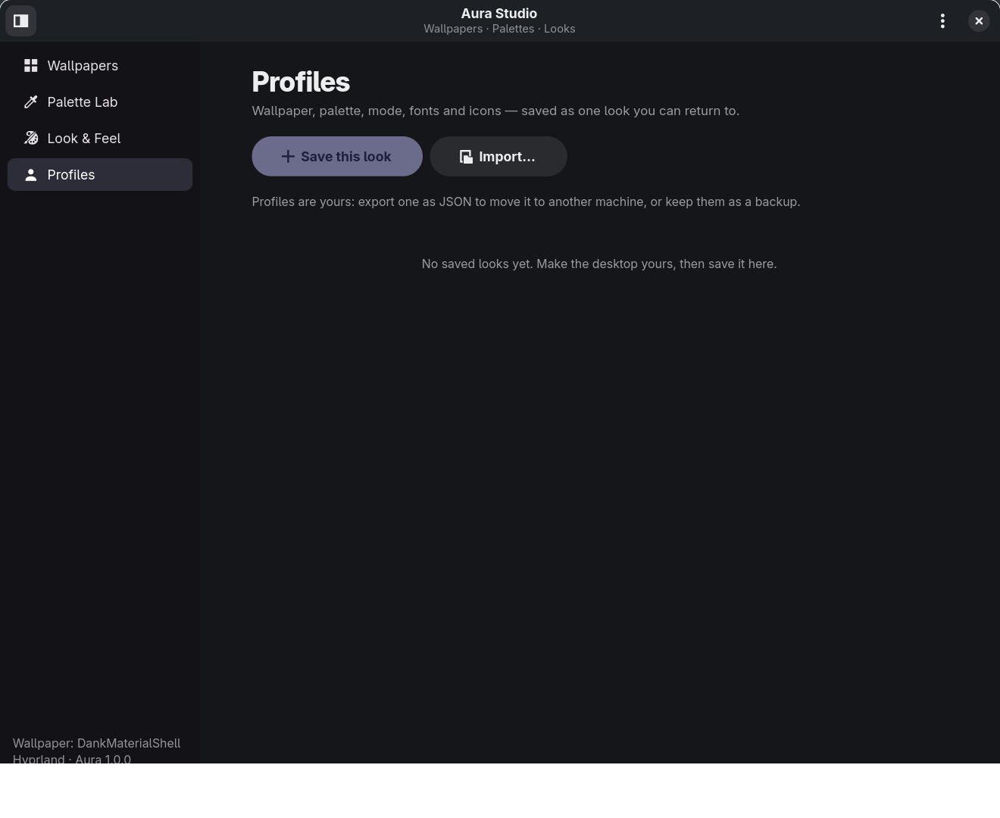

# Aura Studio

**Wallpapers, palettes and desktop looks that work together.**

Aura Studio is a desktop personalisation suite for Linux. It browses your
wallpaper collection, extracts accessible colour palettes from any picture,
applies them to GTK apps and terminals, and saves complete looks you can
switch back to in one click.

It is a new, independent tool inspired by
[Wallpaper Studio](https://github.com/yuxev/wallpaper-studio), built around
three ideas: a real library, a palette laboratory, and reusable profiles.

> **Hybrid Rust edition:** this checkout keeps the Python GTK UI and moves the
> colour/palette engine to Rust through PyO3. See [RUST.md](RUST.md) for the
> build, architecture and fallback details.



## What is inside

### Wallpapers
- A responsive grid of pictures, GIFs and videos from any folder.
- Search, sort, favourites, current-wallpaper marker and a large preview.
- **Set wallpaper**, or **Match colours** to recolour the desktop from the
  same image at the same time.
- Six wallpaper scalings: fill, fit, stretch, centre, tile and span.
- Slideshow that changes wallpaper every 15 minutes to once a day while Aura
  is open, in shuffle or folder order, plus **Next wallpaper**.
- Drag a picture onto the window to apply it.
- Videos are shown and applied through a still frame (ffmpeg); animated GIFs
  are passed to animated backends where available.

### Palette Lab
- Extract a light and a dark palette from any picture, wallpaper or not.
- Four styles: **Vivid**, **Balanced**, **Muted** and **Mono**.
- Custom accent colour, or let the picture pick its most vivid distinct hue.
- Live abstract desktop previews for both modes, with WCAG contrast numbers.
- Every generated palette guarantees ≥ 7:1 body text and ≥ 4.5:1 accent text.
- Copy the palette as JSON, or export a GTK stylesheet, JSON palette or Kitty
  theme.



### Look & Feel
- Light, dark or automatic (light by day, dark at night, times configurable).
- Choose what to recolour: GTK 3/4 apps, terminal colours and the GNOME lock
  screen (when present).
- Optional see-through windows.
- Icon theme, cursor theme and cursor size, interface font, monospace font and
  text scaling.
- **Reapply my look after login**: Aura can run in the background at login,
  restore the selected look, and exit without opening its window. This is
  useful on machines that reset themes, icons, fonts or the wallpaper between
  sessions.
- One **Apply this look** button; nothing changes before you press it.
- **Restore original look** puts back everything Aura changed the first time,
  including the previous wallpaper where the backend supports it.



### Profiles
- Save the wallpaper, palette, mode, style, accent, fonts, icons and options
  as one named look.
- Apply, export to JSON, import back, or delete.
- Profiles are plain JSON and portable between machines.



## Works with your desktop

Aura looks for a wallpaper backend at runtime:

| Session | Backend | What it does |
|---|---|---|
| Hyprland with DankMaterialShell | `dms ipc` | Sets the wallpaper per monitor and keeps DMS in sync |
| Hyprland with hyprpaper | `hyprctl hyprpaper` | Preloads and displays the picture |
| Wayland (wlroots) | `awww` | Starts the daemon if needed and displays the picture |
| Wayland without a daemon | `swaybg` | Runs a small background process |
| X11 | `feh` | Sets the root pixmap |
| GNOME | `gsettings` | Sets `picture-uri` and `picture-uri-dark` |

Colours are applied the same way everywhere: a generated GTK 3/4 theme,
`gtk.css` imports, a Kitty theme include, a GNOME Terminal profile when
available, and standard GNOME desktop settings for icons/fonts/cursor.

## Requirements

Aura uses a **Pixi** environment for Python, GTK 4.10+, libadwaita 1.6+,
GdkPixbuf and the Rust toolchain, so you do not need to install PyGObject or
GTK by hand. Pixi itself is installed by `install.sh` when it is missing.

- Linux x86_64 (Ubuntu, Debian, Arch, Fedora, …)
- X11 or Wayland
- `curl` or `wget` while installing (to bootstrap Pixi)
- Optional system helpers, installed by `install.sh` when possible:
  `ffmpeg` for video thumbnails, `dconf` for GNOME Terminal colours, and `feh`
  for wallpaper on non-GNOME X11 desktops.

No root is needed for the app or the Pixi environment. Optional system helpers
may ask for `sudo`.

If you prefer not to use Pixi, `./install.sh --system` uses your distro's
Python + GTK packages instead:

```sh
sudo apt install python3-gi gir1.2-gtk-4.0 gir1.2-adw-1 \
    gir1.2-gdkpixbuf-2.0 ffmpeg dconf-cli feh   # Ubuntu/Debian
```

## Install and run

```sh
cd ~/Downloads/aura-studio
./install.sh
```

`install.sh` does five things:

1. Installs **Pixi** into `~/.local/bin` if it is not already available.
2. Creates the app environment from `pixi.toml` + `pixi.lock`
   (`pixi install`). The first run downloads GTK, libadwaita and the Rust
   toolchain (about 700 MB).
3. Builds the optional **Rust core** and installs `aura_core.abi3.so` next to
   the Python package. If the build is unavailable, the app uses the Python
   fallback.
4. Adds the `aura-studio` launcher and desktop entry to your user profile.
5. Adds a login autostart entry that reapplies your selected look in the
   background and exits. It also applies an already-saved look once, without
   opening the window. Use `--no-autostart` to skip it.
6. Installs optional helpers such as `ffmpeg`, `dconf-cli` and `feh` with your
   distro's package manager when they are missing.

Then open **Aura Studio** from your app launcher, or run:

```sh
aura-studio
```

If your current shell has not picked up `~/.local/bin` yet, log in again or use
`~/.local/bin/aura-studio`.

You can also run it straight from the project without the launcher:

```sh
./aura-studio
pixi run run
```

If you move the project folder (or switch it to goinfre), the launcher repairs
Pixi's recorded paths automatically on the next run. Nothing has to be
downloaded again.

The launcher can be removed with `./uninstall.sh`; add `--purge` to delete the
local Pixi environment as well. Your pictures and profiles stay in place.

### 42-school machines and goinfre

When `~/goinfre` exists and is writable, Aura uses it automatically for the
large parts of the installation:

| Data | Normal location | With goinfre |
|---|---|---|
| Pixi environment | `.pixi/` in the project | `~/goinfre/aura-studio/pixi/` (`.pixi` becomes a symlink) |
| Pixi package cache | `~/.cache/rattler/` | `~/goinfre/aura-studio/pixi-cache/` |
| Thumbnails and video frames | `~/.cache/aura-studio/` | `~/goinfre/aura-studio/cache/` |

Settings, profiles and the generated GTK colours stay in
`~/.config/aura-studio`, because they are tiny. Set `AURA_GOINFRE` to point at
a different goinfre mount, or `AURA_CACHE_DIR` to override only the cache.

### Keep your look after login

Some lab machines reset their desktop settings when the session ends. Aura's
installer enables a login entry automatically; you can control it in
**Look & Feel → At login**, or from the command line:

```sh
aura-studio autostart on          # enable reapply after login
aura-studio autostart off         # disable it
aura-studio autostart status      # show the current state
aura-studio apply-saved           # do it right now, without opening a window
```

The background run reads the same settings as the window. Choose **Last applied
look** or a saved profile as the login look. Failures are written to
`~/.config/aura-studio/autostart.log`, so a broken login entry is easy to
diagnose.

On a tiling compositor that does not read XDG autostart entries, add the
command to its own startup file, for example in Hyprland:

```sh
exec-once = ~/Documents/tools/aura-studio/aura-studio apply-saved --delay 2 --log
```

### Ubuntu and X11

Aura runs natively on Ubuntu X11:

- **Ubuntu GNOME on Xorg** changes the wallpaper through `gsettings`, which
  works with the lock screen. The login entry reapplies it if the session
  resets it.
- **Other X11 desktops** use `feh`; the installer adds `feh` when needed. The
  login entry reapplies the last wallpaper and every desktop option after a
  logout/reboot (feh cannot remember it by itself). The primary supported X11
  setup is Ubuntu GNOME; on XFCE/KDE the desktop's own wallpaper service may
  take over, while colours, profiles and terminal settings still work.
- **Light/dark colours, icons, fonts and cursor** use standard GNOME settings.
- **Transparent windows** need a compositor. GNOME's Mutter already provides
  one; on other X11 desktops install `picom` and run `picom --daemon`.
- The Pixi activation script (`scripts/activate.sh`) connects the Pixi GLib
  stack to your real dconf settings, so “Apply this look” changes your actual
  desktop rather than the isolated environment.

If you ever suspect the Pixi environment is the problem, compare with:

```sh
AURA_USE_SYSTEM=1 ./aura-studio
```

Then report which one behaves differently.

## Quick start

1. Open **Wallpapers** — it starts in `~/Pictures/wallpapers` when that folder
   exists. Use the folder button to choose another one.
2. Click a picture to preview its palette, then **Set wallpaper**.
3. Open **Palette Lab** to fine-tune the accent or style and press
   **Apply colours**.
4. Open **Look & Feel** to choose light/dark/auto, icons, fonts and terminal
   colours, then **Apply this look**.
5. Open **Profiles** and save the result. Later, apply it with one click.
6. In **Look & Feel → At login**, keep **Reapply my look after login** on and
   choose the last applied look or a saved profile.
7. If you ever want your old desktop back, use **Restore original look**
   (sidebar or ⋮ menu).

## Command line

```
aura-studio                          open the window
aura-studio set FILE                 set a picture/video and match the colours
aura-studio set FILE --no-colors     set only the wallpaper
aura-studio next                     the next wallpaper from your folder
aura-studio light | dark | auto      change colour mode using the applied palette
aura-studio palette FILE             print the palette extracted from a picture
aura-studio palette FILE --json      print it as JSON (also --css)
aura-studio profiles                 list saved profiles
aura-studio apply-profile NAME       apply a saved profile by name or id
aura-studio apply-saved              reapply the saved look, then exit
aura-studio autostart on | off       enable/disable reapply after login
aura-studio autostart status         show whether login reapply is enabled
aura-studio reapply-wallpaper        restore the last wallpaper
aura-studio restore                  undo everything Aura changed
aura-studio status                   show backend, session, mode and wallpaper
```

## Where everything lives

| Path | Contents |
|---|---|
| `~/.config/aura-studio/config.json` | folder, mode, style, accent, favourites, options |
| `~/.config/aura-studio/state.json` | the applied wallpaper and palette |
| `~/.config/aura-studio/originals.json` | snapshot used by Restore |
| `~/.config/aura-studio/theme.css` | the generated GTK colours |
| `~/.config/aura-studio/profiles/` | saved looks |
| `~/.config/aura-studio/exports/` | terminal colour snippets from the last apply |
| `~/.config/aura-studio/hooks/` | optional post-recolour scripts |
| `~/.config/aura-studio/autostart.log` | result of the last login reapply |
| `~/.config/autostart/io.github.AuraStudio.apply.desktop` | login reapply entry |
| `~/.cache/aura-studio/thumbs/` | cached thumbnails |
| `~/.cache/aura-studio/frames/` | frames extracted from videos |
| `~/goinfre/aura-studio/cache/` | the same cache, when goinfre exists |
| `~/.local/share/themes/Aura A`, `Aura B` | the two identical generated themes used to make GTK reload live |
| `.pixi/envs/default/` | the self-contained Pixi runtime (Python, GTK, libadwaita) |
| `~/goinfre/aura-studio/pixi/` | the same runtime, when goinfre exists |
| `pixi.toml`, `pixi.lock` | reproducible Pixi environment definition |
| `scripts/activate.sh` | connects Pixi GLib to the real dconf settings backend |

Set `AURA_CONFIG_DIR` and `AURA_CACHE_DIR` to use different locations (useful
for tests). `AURA_GOINFRE` overrides the goinfre mount, and `AURA_USE_SYSTEM=1`
skips the Pixi environment.

## Hooks

After every recolour, Aura runs each executable file in
`~/.config/aura-studio/hooks/` (name order, in the background). The current
palette is available as environment variables:

| Variable | Value |
|---|---|
| `AURA_MODE` | `light` or `dark` |
| `AURA_PAPER`, `AURA_PAPER2`, `AURA_SHEET`, `AURA_INK`, `AURA_MUTED` | colours |
| `AURA_ACCENT`, `AURA_ACCENT_TEXT`, `AURA_ON_ACCENT` | accent colours |
| `AURA_ANSI_0` … `AURA_ANSI_15` | terminal palette |
| `AURA_STATE` | path to `state.json` |

Example `~/.config/aura-studio/hooks/kitty-extra`:

```sh
#!/bin/sh
printf 'background %s\nforeground %s\n' "$AURA_PAPER" "$AURA_INK" > ~/.config/kitty/aura-extra.conf
```

## How it works

- `crates/aura-core/` — Rust OKLab/OKLCH colour maths, deterministic k-means
  clustering, accent selection and accessible light/dark palettes.
- `crates/aura-py/` — PyO3 bindings exposed as the `aura_core` module.
- `aura_studio/color.py`, `aura_studio/palette.py` — Rust-first wrappers with
  the original pure-Python engines in `_color_py.py` and `_palette_py.py` as a
  fallback.
- `aura_studio/library.py` — folder scanning, video frames and cached
  thumbnails.
- `aura_studio/system.py` — wallpaper backends, GTK themes, terminal profiles,
  lock screen, desktop settings, originals/restore.
- `aura_studio/core.py` — the high-level actions shared by the window and CLI.
- `aura_studio/library_page.py`, `palette_page.py`, `look_page.py`,
  `profiles_page.py` — the four screens.
- `aura_studio/app.py` — the application window, actions and timers.
- `pixi.toml`, `pixi.lock`, `scripts/activate.sh` — the self-contained runtime
  and the bridge to the host's real dconf/GSettings database.
- `scripts/fix-pixi-prefix.py` — repairs a Pixi environment after the checkout
  or the goinfre symlink moved, instead of downloading GTK again.

## Tests

```sh
pixi run test
```

Or, with the system Python:

```sh
python3 -m unittest discover -s tests -v
```

The system test uses a throwaway HOME and an in-memory GSettings backend, so it
never touches your real desktop. There is also an X11 smoke test you can run
yourself on an Xorg session:

```sh
pixi run x11
# or: GDK_BACKEND=x11 ./aura-studio
```

It should behave exactly like the Wayland run; only the wallpaper backend
changes (GNOME settings or feh).

## Limits

- Slideshow and automatic light/dark switching run while the Aura window is
  open. The login entry only reapplies the saved look once and exits; it does
  not keep a daemon running.
- Videos become a still frame unless your wallpaper backend supports video
  itself.
- libadwaita apps (Settings, Text Editor, …) read their colours when they
  start; already-open ones may need a restart. GTK 3 apps and terminal windows
  usually update live.
- Lock-screen colours/picture are only applied on GNOME.
- Restoring the wallpaper itself is automatic with GNOME and DMS; other
  backends keep the last wallpaper because they do not expose a reliable
  “current wallpaper” readback.

## Credits

Inspired by [Wallpaper Studio](https://github.com/yuxev/wallpaper-studio) by
yuxev (MIT). Aura Studio is a separate implementation with a new palette engine,
library UI, profile system and multi-desktop backends.

MIT licensed — see [LICENSE](LICENSE).
