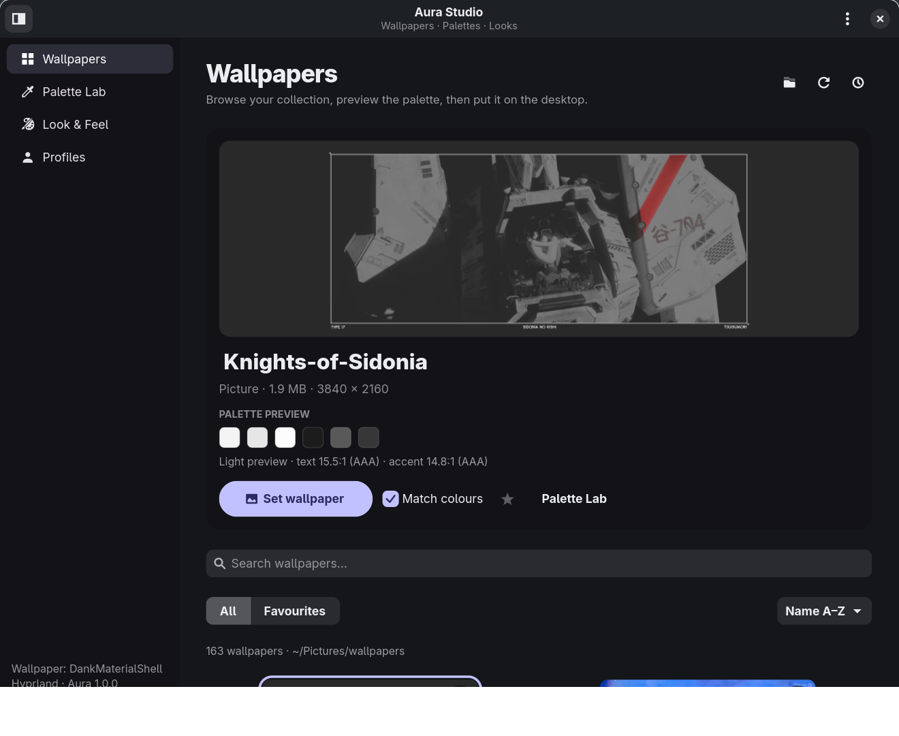
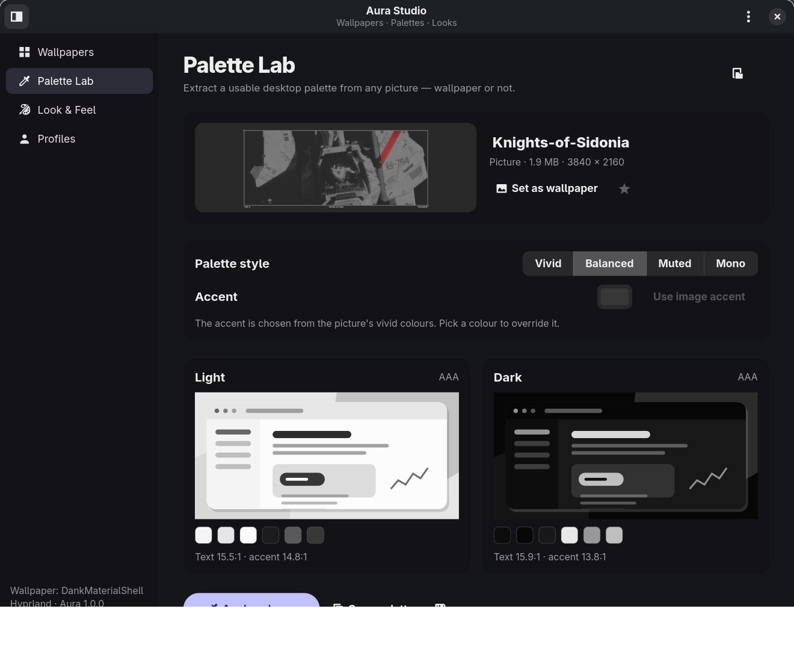
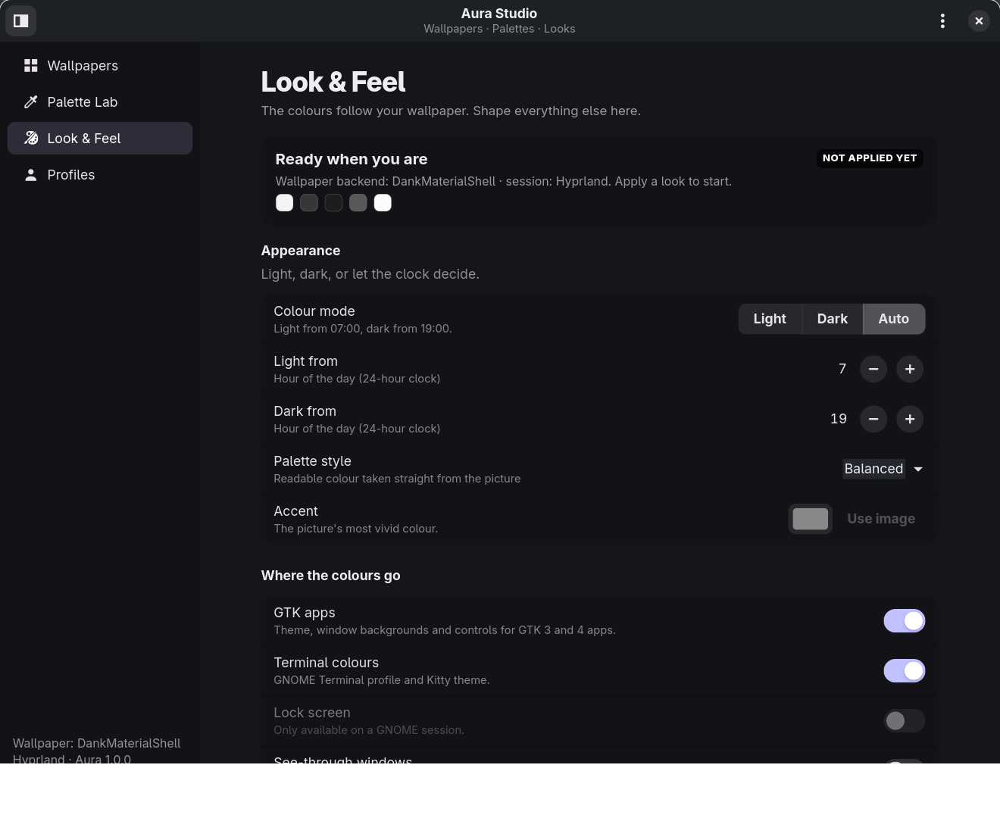
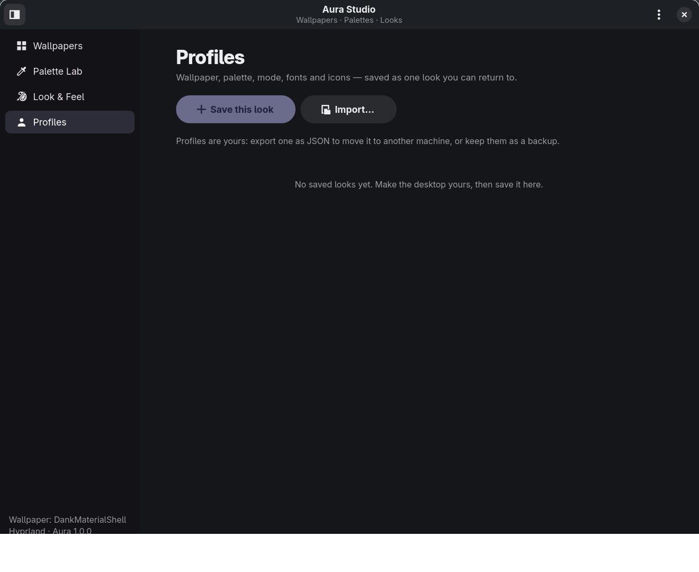

# Aura Studio

**Wallpapers, palettes and desktop looks that work together.**

Aura Studio is a desktop personalisation suite for Linux. It browses your
wallpaper collection, extracts accessible colour palettes from any picture,
applies them to GTK apps and terminals, and saves complete looks you can
switch back to in one click.

It is a new, independent tool inspired by
[Wallpaper Studio](https://github.com/yuxev/wallpaper-studio), built around
three ideas: a real library, a palette laboratory, and reusable profiles.



## What is inside

### Wallpapers
- A responsive grid of pictures, GIFs and videos from any folder.
- Search, sort, favourites, current-wallpaper marker and a large preview.
- **Set wallpaper**, or **Match colours** to recolour the desktop from the
  same image at the same time.
- Slideshow that changes wallpaper every 15 minutes to once a day while Aura
  is open, plus **Shuffle now**.
- Drag a picture onto the window to apply it.
- Videos are shown and applied through a still frame (ffmpeg); animated GIFs
  are passed to animated backends where available.

### Palette Lab
- Extract a light and a dark palette from any picture, wallpaper or not.
- Four styles: **Vivid**, **Balanced**, **Muted** and **Mono**.
- Custom accent colour, or let the picture pick its most vivid distinct hue.
- Live abstract desktop previews for both modes, with WCAG contrast numbers.
- Every generated palette guarantees ≥ 7:1 body text and ≥ 4.5:1 accent text.
- Copy the palette as JSON, or export a GTK stylesheet, JSON palette or Kitty
  theme.



### Look & Feel
- Light, dark or automatic (light by day, dark at night, times configurable).
- Choose what to recolour: GTK 3/4 apps, terminal colours and the GNOME lock
  screen (when present).
- Optional see-through windows.
- Icon theme, cursor theme, interface font, monospace font and text scaling.
- One **Apply this look** button; nothing changes before you press it.
- **Restore original look** puts back everything Aura changed the first time,
  including the previous wallpaper where the backend supports it.



### Profiles
- Save the wallpaper, palette, mode, style, accent, fonts, icons and options
  as one named look.
- Apply, export to JSON, import back, or delete.
- Profiles are plain JSON and portable between machines.



## Works with your desktop

Aura looks for a wallpaper backend at runtime:

| Session | Backend | What it does |
|---|---|---|
| Hyprland with DankMaterialShell | `dms ipc` | Sets the wallpaper per monitor and keeps DMS in sync |
| Hyprland with hyprpaper | `hyprctl hyprpaper` | Preloads and displays the picture |
| Wayland (wlroots) | `awww` | Starts the daemon if needed and displays the picture |
| Wayland without a daemon | `swaybg` | Runs a small background process |
| X11 | `feh` | Sets the root pixmap |
| GNOME | `gsettings` | Sets `picture-uri` and `picture-uri-dark` |

Colours are applied the same way everywhere: a generated GTK 3/4 theme,
`gtk.css` imports, a Kitty theme include, a GNOME Terminal profile when
available, and standard GNOME desktop settings for icons/fonts/cursor.

## Requirements

- Linux with Python 3.10+
- Python 3 GI bindings for **GTK 4.10+**, **libadwaita 1.6+** and **GdkPixbuf**
- `ffmpeg` for video thumbnails/frames (optional, but recommended)
- A wallpaper backend from the table above (optional for the Palette Lab and
  profiles; required to actually change the wallpaper)

On Debian/Ubuntu:

```sh
sudo apt install python3-gi gir1.2-gtk-4.0 gir1.2-adw-1 ffmpeg
```

## Run it

From this folder, with no installation:

```sh
./aura-studio
```

Or install a launcher for the current user (no sudo, creates nothing in system
directories):

```sh
./install.sh
```

Then open **Aura Studio** from your app launcher or run:

```sh
aura-studio
```

The launcher can be removed with `./uninstall.sh`. Your pictures and profiles
stay in place.

## Quick start

1. Open **Wallpapers** — it starts in `~/Pictures/wallpapers` when that folder
   exists. Use the folder button to choose another one.
2. Click a picture to preview its palette, then **Set wallpaper**.
3. Open **Palette Lab** to fine-tune the accent or style and press
   **Apply colours**.
4. Open **Look & Feel** to choose light/dark/auto, icons, fonts and terminal
   colours, then **Apply this look**.
5. Open **Profiles** and save the result. Later, apply it with one click.
6. If you ever want your old desktop back, use **Restore original look**
   (sidebar or ⋮ menu).

## Command line

```
aura-studio                          open the window
aura-studio set FILE                 set a picture/video and match the colours
aura-studio set FILE --no-colors     set only the wallpaper
aura-studio next                     a random different wallpaper from your folder
aura-studio light | dark | auto      change colour mode using the applied palette
aura-studio palette FILE             print the palette extracted from a picture
aura-studio palette FILE --json      print it as JSON (also --css)
aura-studio profiles                 list saved profiles
aura-studio apply-profile NAME       apply a saved profile by name or id
aura-studio restore                  undo everything Aura changed
aura-studio status                   show backend, session, mode and wallpaper
```

## Where everything lives

| Path | Contents |
|---|---|
| `~/.config/aura-studio/config.json` | folder, mode, style, accent, favourites, options |
| `~/.config/aura-studio/state.json` | the applied wallpaper and palette |
| `~/.config/aura-studio/originals.json` | snapshot used by Restore |
| `~/.config/aura-studio/theme.css` | the generated GTK colours |
| `~/.config/aura-studio/profiles/` | saved looks |
| `~/.config/aura-studio/exports/` | terminal colour snippets from the last apply |
| `~/.config/aura-studio/hooks/` | optional post-recolour scripts |
| `~/.cache/aura-studio/thumbs/` | cached thumbnails |
| `~/.cache/aura-studio/frames/` | frames extracted from videos |
| `~/.local/share/themes/Aura A`, `Aura B` | the two identical generated themes used to make GTK reload live |

Set `AURA_CONFIG_DIR` and `AURA_CACHE_DIR` to use different locations (useful
for tests).

## Hooks

After every recolour, Aura runs each executable file in
`~/.config/aura-studio/hooks/` (name order, in the background). The current
palette is available as environment variables:

| Variable | Value |
|---|---|
| `AURA_MODE` | `light` or `dark` |
| `AURA_PAPER`, `AURA_PAPER2`, `AURA_SHEET`, `AURA_INK`, `AURA_MUTED` | colours |
| `AURA_ACCENT`, `AURA_ACCENT_TEXT`, `AURA_ON_ACCENT` | accent colours |
| `AURA_ANSI_0` … `AURA_ANSI_15` | terminal palette |
| `AURA_STATE` | path to `state.json` |

Example `~/.config/aura-studio/hooks/kitty-extra`:

```sh
#!/bin/sh
printf 'background %s\nforeground %s\n' "$AURA_PAPER" "$AURA_INK" > ~/.config/kitty/aura-extra.conf
```

## How it works

- `aura_studio/color.py` — OKLab/OKLCH colour maths and WCAG contrast.
- `aura_studio/palette.py` — deterministic k-means colour clustering, accent
  selection, accessible light/dark palettes, GTK CSS and terminal exports.
- `aura_studio/library.py` — folder scanning, video frames and cached
  thumbnails.
- `aura_studio/system.py` — wallpaper backends, GTK themes, terminal profiles,
  lock screen, desktop settings, originals/restore.
- `aura_studio/core.py` — the high-level actions shared by the window and CLI.
- `aura_studio/library_page.py`, `palette_page.py`, `look_page.py`,
  `profiles_page.py` — the four screens.
- `aura_studio/app.py` — the application window, actions and timers.

## Tests

```sh
python3 -m unittest discover -s tests -v
```

The system test uses a throwaway HOME and an in-memory GSettings backend, so it
never touches your real desktop.

## Limits

- Slideshow and automatic light/dark switching run while the Aura window is
  open. A future version can install a small user service for background
  switching.
- Videos become a still frame unless your wallpaper backend supports video
  itself.
- libadwaita apps (Settings, Text Editor, …) read their colours when they
  start; already-open ones may need a restart. GTK 3 apps and terminal windows
  usually update live.
- Lock-screen colours/picture are only applied on GNOME.
- Restoring the wallpaper itself is automatic with GNOME and DMS; other
  backends keep the last wallpaper because they do not expose a reliable
  “current wallpaper” readback.

## Credits

Inspired by [Wallpaper Studio](https://github.com/yuxev/wallpaper-studio) by
yuxev (MIT). Aura Studio is a separate implementation with a new palette engine,
library UI, profile system and multi-desktop backends.

MIT licensed — see [LICENSE](LICENSE).
